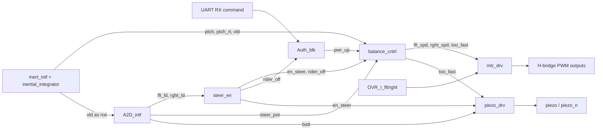

# Digital Control System / Segway Controller

This repository is not a generic “digital control system” starter project. It is a fairly complete SystemVerilog implementation of a self-balancing two-wheel platform controller, plus simulation models, testbenches, synthesis scripts, and FPGA implementation artifacts.

The design behaves like a Segway-style balancing controller:

- it receives a power/authorization command over UART,
- initializes and reads an inertial sensor over SPI,
- samples rider load cells, steering pot, and battery voltage through an external ADC,
- estimates platform pitch,
- runs a PID-based balance loop,
- converts that control effort into left/right motor commands,
- enables steering only when a rider is properly centered,
- shuts down or warns on rider-off, low battery, overspeed, or repeated motor over-current.

This README is a code-driven explanation of what the repository actually does, how the major files fit together, and how data moves through the system.

---

## 1. What the design does

At a system level, the controller tries to keep a rider-balanced platform upright while allowing limited steering and handling a few safety conditions.

There are four main subsystems:

1. **Authorization / enable**  
	A UART command powers the balancing loop on and off.

2. **Sensing**  
	An inertial sensor provides pitch-rate and acceleration-derived pitch information.  
	An external ADC provides left load, right load, steering pot, and battery voltage.

3. **Control**  
	A PID controller computes the base balancing effort.  
	A steering stage adds differential left/right motor bias when the rider is stably on board.

4. **Actuation / feedback**  
	A motor driver generates complementary PWM outputs for two H-bridges.  
	A piezo driver generates tones for enable, low-battery, and overspeed conditions.

---

## 2. Top-level architecture

The top-level module is `Segway`.

### Top-level ports

- **Clock / reset**: `clk`, `RST_n`
- **Inertial sensor SPI**: `INERT_SS_n`, `INERT_MOSI`, `INERT_SCLK`, `INERT_MISO`, `INERT_INT`
- **ADC SPI**: `A2D_SS_n`, `A2D_MOSI`, `A2D_SCLK`, `A2D_MISO`
- **Motor outputs**: `PWM1_lft`, `PWM2_lft`, `PWM1_rght`, `PWM2_rght`
- **Motor fault inputs**: `OVR_I_lft`, `OVR_I_rght`
- **Audio outputs**: `piezo`, `piezo_n`
- **UART authorization input**: `RX`

### Actual top-level composition

The `Segway` module instantiates:

- `rst_synch`
- `Auth_blk`
- `inert_intf`
- `A2D_intf`
- `steer_en`
- `balance_cntrl`
- `mtr_drv`
- `piezo_drv`

### System dataflow



---

## 3. End-to-end workflow

### Power-up / startup sequence

1. **Reset is synchronized** by `rst_synch`.
2. **Authorization stays off** until UART receives `'G'` (`0x47`).
3. `inert_intf` **initializes the inertial sensor** over SPI.
4. Once the inertial sensor begins generating interrupts, `inert_intf` repeatedly reads pitch-rate and acceleration data.
5. `A2D_intf` continuously samples one analog channel per `vld` pulse in a round-robin sequence.
6. When rider weight is detected and balanced for long enough, `steer_en` asserts `en_steer`.
7. `balance_cntrl` ramps motor effort up gradually using a **soft-start timer**.
8. `mtr_drv` converts signed speed commands into PWM for the motor H-bridges.
9. `piezo_drv` plays an enable melody when steering becomes active.

### Shut-down behavior

The design powers down when:

- UART receives `'S'` (`0x53`) **and** `rider_off` is true immediately, or
- UART receives `'S'` while the rider is still on the platform, then `Auth_blk` waits until `rider_off` becomes true.

### Normal closed-loop behavior

In normal operation:

1. `inert_intf` produces a new inertial sample and asserts `vld`.
2. `PID` updates its proportional, integral, and derivative terms on `vld`.
3. `Segway_Math` applies soft-start scaling, steering bias, dead-zone shaping, and saturation.
4. `mtr_drv` updates PWM drive on PWM-cycle boundaries.
5. The simulated plant (`SegwayModel` in testbench) responds by changing pitch and pitch rate.

---

## 4. Module-by-module explanation

## 4.1 `Segway.sv` — top-level integrator

This is the control shell that wires the whole design together.

### Key internal signals

- `rst_n`: synchronized reset
- `vld`: new inertial sample available
- `ptch`, `ptch_rt`: inertial state inputs to control loop
- `lft_spd`, `rght_spd`: signed speed commands to motor driver
- `lft_ld`, `rght_ld`: load-cell readings
- `steer_pot`: steering input
- `batt`: battery ADC reading
- `pwr_up`: authorization-enabled balance mode
- `en_steer`: rider stable enough to allow steering
- `rider_off`: no rider present / rider has stepped off
- `too_fast`: overspeed indicator from control math
- `batt_low`: battery comparator against `12'h800`

### Important note

The checked-in top-level sets:

```sv
localparam fast_sim = 1;
```

That means the current committed top-level is configured for **fast simulation timing**, not full real-time hardware delays. The logic is still representative, but timer-based behaviors are accelerated.

---

## 4.2 `Auth_blk.sv` — UART authorization and power state

`Auth_blk` controls whether the balance loop is logically powered.

### Behavior

- Accepts `'G'` (`0x47`) to enter powered state.
- Accepts `'S'` (`0x53`) to request shutdown.
- If `'S'` arrives while a rider is still on the platform, it waits until `rider_off` before returning to idle.

### Internal structure

- `UART_rx` receives bytes on `RX`.
- A 3-state FSM manages power status:
  - `IDLE`
  - `ARMED`
  - `WAIT`

### `UART_rx` details

- Uses a 2-flop synchronizer on `RX`.
- Detects a falling edge for the UART start bit.
- Samples each bit near its midpoint.
- The constant `BANDD_COUNT = 5208` implies roughly **9600 baud** at a 50 MHz clock.

So the current code is **not** running at 115200 baud; it is coded for about 9600 baud.

---

## 4.3 `inert_intf.sv` — inertial sensor SPI interface

This module initializes and polls the inertial sensor.

### Responsibilities

- Synchronize the inertial interrupt input `INT`.
- Perform startup register writes.
- Read pitch-rate and acceleration bytes over SPI.
- Assemble those bytes into `ptch_rt` and `AZ` values.
- Assert `vld` when a complete sensor update is ready.

### FSM sequence

The FSM walks through these stages:

- `INIT1`
- `INIT2`
- `INIT3`
- `INIT4`
- `WAIT`
- `PTCHL`
- `PTCHH`
- `AZL`
- `AZH`

### Initialization writes

The module writes several fixed 16-bit commands, including:

- `16'h0D02`
- `16'h1053`
- `16'h1150`
- `16'h1460`

These configure the inertial sensor before normal acquisition begins.

### Acquisition path

After interrupt:

1. read pitch-rate low byte,
2. read pitch-rate high byte,
3. read acceleration-Z low byte,
4. read acceleration-Z high byte,
5. assert `vld` for one cycle.

### Output filtering

When `fast_sim == 0`, the module suppresses extreme `ptch_rt` values outside about `±16'h1F00` by replacing them with zero. In fast simulation, the raw value is passed through.

---

## 4.4 `inertial_integrator.sv` — pitch estimator / sensor fusion

This module produces the platform pitch estimate `ptch`.

### Inputs

- `ptch_rt`: gyro-derived pitch rate
- `AZ`: accelerometer Z-axis reading
- `vld`: update strobe

### How it works

It implements a simple fusion method:

1. subtract sensor offsets,
2. integrate the negative pitch-rate term into a 27-bit accumulator,
3. derive a rough pitch estimate from `AZ`,
4. nudge the integrated pitch toward that accelerometer estimate by `±1024` each valid sample.

This is effectively a lightweight complementary fusion approach:

- gyro gives short-term dynamics,
- accelerometer slowly corrects long-term drift.

### Output scaling

The published pitch output is the upper bits of the internal accumulator:

- internal state: `ptch_int[26:0]`
- output: `ptch = ptch_int[26:11]`

---

## 4.5 `A2D_Intf.sv` — analog input acquisition

This module reads an external ADC over SPI.

### Channel mapping used by the design

- channel `0`: left load cell
- channel `4`: right load cell
- channel `5`: steering potentiometer
- channel `6`: battery voltage

### FSM behavior

States:

- `IDLE`
- `CHANNEL`
- `WAIT`
- `READ`

For each `nxt` pulse:

1. send a transaction selecting the next ADC channel,
2. wait one cycle,
3. send a second transaction to read the result,
4. store the 12-bit conversion result,
5. advance the round-robin channel selector.

### Important system implication

`A2D_intf` uses `vld` from the inertial interface as `nxt`.  
That means **each inertial update only advances one ADC channel**. So a full refresh of all four analog measurements takes four inertial sample events.

This is a key part of the real dataflow:

- inertial loop runs fastest,
- analog readings are staggered behind it.

---

## 4.6 `SPI_mnrch.sv` — reusable SPI master

This is the shared SPI engine used by both `inert_intf` and `A2D_intf`.

### Structure

FSM states:

- `IDLE`
- `FRONT_PORCH`
- `WORK_HORSE`
- `BACK_PORCH`

### Behavior

- loads a 16-bit transmit word on `wrt`,
- shifts one bit per SCLK phase,
- samples `MISO` mid-bit,
- returns `done` at end of transaction,
- keeps `SS_n` low during transfer.

### Timing

`SCLK` is derived from a 4-bit divider, so with a 50 MHz system clock the SPI clock is effectively about:

$$
50\text{ MHz} / 16 \approx 3.125\text{ MHz}
$$

---

## 4.7 `balance_cntrl.sv` — wrapper around control pipeline

This module does not contain the control math itself; it is mostly a clean wrapper tying together:

- `PID`
- `Segway_Math`

### Inputs

- `ptch`, `ptch_rt`, `vld`
- `pwr_up`
- `rider_off`
- `steer_pot`
- `en_steer`

### Outputs

- `lft_spd`
- `rght_spd`
- `too_fast`

The overall control path is:

```text
ptch / ptch_rt --→ PID --→ PID_cntrl + ss_tmr --→ Segway_Math --→ lft_spd / rght_spd / too_fast
```

---

## 4.8 `PID.sv` — balancing controller core

This is the main upright-balance controller.

### Implemented terms

- **P-term** from saturated pitch error
- **I-term** from accumulated pitch error
- **D-term** from pitch rate

### Details that matter

#### Pitch error saturation

`ptch` is saturated to approximately:

$$
-512 \le \text{ptch\_err\_sat} \le 511
$$

This keeps large-angle readings from exploding the loop gain.

#### Proportional gain

The code uses:

- `P_COEFF = 5'h09`

So the proportional term is approximately:

$$
P = 9 \cdot \text{ptch\_err\_sat}
$$

#### Integral term

- 18-bit signed accumulator
- only updates when `vld` is high
- cleared immediately when `rider_off` is high
- contains signed overflow protection

#### Derivative term

Implemented as a dampening term from pitch rate:

$$
D \approx -\text{ptch\_rt} >> 6
$$

#### Soft-start timer

The module also generates `ss_tmr`, an 8-bit ramp that gradually enables full control output after power-up.

This prevents abrupt motor startup.

#### Final output saturation

The final PID output is saturated to a signed 12-bit range:

$$
-2048 \le \text{PID\_cntrl} \le 2047
$$

---

## 4.9 `SegwayMath.sv` — post-PID shaping, steering, and speed split

This module turns a single balancing effort into left/right motor speed commands.

### Pipeline stages

#### 1. Soft-start scaling

The signed PID output is multiplied by `ss_tmr`, then scaled down by taking upper bits. This creates a gradual ramp-in of motor command after startup.

#### 2. Steering normalization

The steering potentiometer is:

- clamped to `0x200 .. 0xE00`,
- centered around `0x7FF`,
- scaled by about `3/16`.

#### 3. Left/right torque split

- left torque = PID + steering
- right torque = PID - steering

only when `en_steer` is high. Otherwise both sides get identical balancing torque.

#### 4. Dead-zone shaping

The `deadzn_shaping` submodule compensates for motor dead-zone and low-torque inefficiency.

Behavior:

- for small torque magnitudes, scale by `×4`
- once outside a threshold band, add or subtract a minimum duty offset (`168`)

This is a practical motor-drive linearization step.

#### 5. Saturation and overspeed detection

Outputs are saturated to signed 12-bit speed commands.

`too_fast` is asserted when either output exceeds about `0x600` in the forward direction, which is used by the piezo warning logic.

---

## 4.10 `steer_en.sv` — rider presence and steering qualification

This block decides when steering is allowed and when the rider is considered off the platform.

### Inputs used

- `lft_ld`
- `rght_ld`

### Derived checks

- total weight high enough to qualify a rider,
- total weight low enough to declare rider gone,
- left/right balance within tolerance,
- large imbalance indicating a foot is stepping off.

### Hysteresis thresholds in the actual code

The code uses precomputed thresholds equivalent to:

- enable threshold: total load `> 0x240`
- rider-off threshold: total load `< 0x1C0`

This is the classic hysteresis pattern:

- one threshold to turn on,
- another threshold to turn off,
- avoid chatter around the boundary.

### Balance checks

- if load difference exceeds **one quarter** of total load, the timer is reset,
- if load difference exceeds roughly **15/16** of total load, the rider is treated as stepping off.

### Timer

Before steering is enabled, the rider must remain sufficiently balanced for about **1.34 seconds** in normal mode.

When `fast_sim` is active, the timer finishes much sooner.

---

## 4.11 `steer_en_SM.sv` — steering state machine

This is the FSM used by `steer_en`.

States:

- `INIT`: no rider / steering disabled / `rider_off=1`
- `WAIT`: rider detected but not yet stably centered
- `ENABLE`: steering allowed

### Behavior summary

- `INIT -> WAIT` when rider weight exceeds upper hysteresis threshold
- `WAIT -> ENABLE` when timer completes and rider remains balanced
- `ENABLE -> WAIT` when rider starts stepping off
- `WAIT/ENABLE -> INIT` when total weight drops below lower threshold

The output meaning is important:

- `en_steer` only goes high in `ENABLE`
- `rider_off` is high when no rider is considered present

---

## 4.12 `mtr_drv.sv` — motor command to safe PWM drive

This block turns signed speed commands into physical motor outputs.

### Responsibilities

- synchronize speed updates to the PWM cycle boundary,
- convert signed speed into H-bridge drive representation,
- instantiate one `PWM11` per motor,
- monitor over-current inputs,
- blank false over-current detections near switching edges,
- shut down if over-current occurs too often.

### How signed speed is represented

The code offsets the signed speed by `12'h800` before sending it to the PWM stage. This creates a center point around half scale, letting deviations around center encode direction and magnitude.

### Over-current protection

- `OVR_I_lft` and `OVR_I_rght` are synchronized.
- A rise in over-current increments a 5-bit event counter.
- The count decays slowly: one decrement every 16 PWM cycles.
- If the count reaches `31`, `OVR_I_shtdwn` latches high.
- While current fault logic is active, all PWM outputs are forced low.

This gives the design both:

- transient immunity,
- eventual shutoff for persistent fault conditions.

---

## 4.13 `PWM11.sv` — dual-output non-overlap PWM generator

This module generates the actual switching waveform per motor.

### Key features

- 11-bit free-running counter
- 2048-count PWM period
- approximately **24.41 kHz** PWM at 50 MHz
- complementary outputs `PWM1` and `PWM2`
- enforced non-overlap dead time of `64` counts
- `PWM_synch` pulse at counter wrap
- `ovr_I_blank` blanking windows after switching events

### Why it matters

This is the bridge between abstract motor speed commands and H-bridge-safe switching activity.

The non-overlap avoids shoot-through. The blanking window prevents the over-current logic from reacting to switching spikes.

---

## 4.14 `piezo_drv.sv` — audible feedback / warnings

This module generates sound patterns on `piezo` / `piezo_n`.

### Inputs used

- `en_steer`
- `too_fast`
- `batt_low`

### Tone behavior

It defines note periods for:

- `G6`
- `C7`
- `E7`
- `G7`

### High-level behavior

- **Enable melody**: played when steering first becomes enabled and the repeat timer allows it.
- **Low-battery warning**: periodic pattern every few seconds.
- **Too-fast warning**: loops the first few notes while `too_fast` remains asserted.

### Timing behavior

The module keeps a repeat counter so some warning patterns are not played continuously. In normal mode the repeat interval is on the order of a few seconds; in fast simulation it is shortened.

---

## 4.15 `rst_synch.v` — reset synchronizer

Simple two-stage reset synchronization:

- asynchronous assertion from raw `RST_n`
- synchronous release into internal `rst_n`

This avoids releasing the whole design from reset on an unsafe edge.

---

## 5. Dataflow in detail

## 5.1 Sensor dataflow

### Inertial path

```text
INERT_INT
  -> inert_intf interrupt synchronizer
  -> SPI reads ptch_rt low/high and AZ low/high
  -> inertial_integrator
  -> ptch, ptch_rt, vld
```

### Analog path

```text
vld
  -> A2D_intf nxt
  -> select one ADC channel
  -> second SPI transaction reads that channel
  -> update one of {lft_ld, rght_ld, steer_pot, batt}
```

This means inertial updates are the pacing source for the rest of the acquisition chain.

## 5.2 Control dataflow

```text
ptch + ptch_rt + rider_off + pwr_up
  -> PID
  -> PID_cntrl + ss_tmr
  -> Segway_Math + steer_pot + en_steer
  -> lft_spd + rght_spd + too_fast
```

## 5.3 Safety/control interaction dataflow

```text
lft_ld + rght_ld -> steer_en -> en_steer + rider_off
rider_off -> Auth_blk and PID reset behavior
batt -> batt_low -> piezo_drv
too_fast -> piezo_drv
OVR_I_lft/rght -> mtr_drv shutdown path
```

## 5.4 Actuation dataflow

```text
lft_spd / rght_spd
  -> mtr_drv
  -> PWM11 left/right
  -> PWM1/PWM2 outputs for each motor
```

---

## 6. Timing and “pipeline” view

If by “pipeline” you mean the runtime processing pipeline, the design looks like this:

| Stage | Trigger | Main logic | Output |
|---|---|---|---|
| 1 | inertial interrupt | `inert_intf` SPI reads | raw `ptch_rt`, `AZ` |
| 2 | `vld` | `inertial_integrator` | `ptch` |
| 3 | `vld` | `PID` | `PID_cntrl`, `ss_tmr` |
| 4 | same cycle / pipelined math | `Segway_Math` | `lft_spd`, `rght_spd`, `too_fast` |
| 5 | PWM sync | `mtr_drv` | cycle-aligned speed update |
| 6 | free-running PWM | `PWM11` | H-bridge drive signals |

There are also two slower parallel loops:

- **ADC round-robin loop** for rider/battery/steering measurements
- **piezo repeat loop** for audible feedback timing

---

## 7. Verification environment

The repository includes a real simulation harness, not just isolated RTL.

## 7.1 `SegwayModel.sv` — behavioral plant model

This is the most important support model.

It simulates:

- inertial sensor SPI behavior,
- inertial interrupt generation,
- wheel torque from PWM duty,
- wheel angular velocity and position,
- platform rotation / pitch dynamics,
- rider lean acting as an external disturbance/input.

In other words, the control RTL is tested against a simplified **plant + sensor model**, not just forced register values.

## 7.2 `ADC128S_FC.sv` — controllable ADC model

This ADC model returns externally assigned values for:

- left load cell,
- right load cell,
- steering pot,
- battery voltage.

It is used by the system-level testbenches so scenarios can be scripted directly.

## 7.3 `ADC128S.sv` — simple self-generated ADC model

This is a simpler ADC model variant that generates internally changing values and warns if unsupported channels are selected.

## 7.4 `UART_tx.sv`

This testbench-side UART transmitter mimics a BLE/host module sending `'G'` and `'S'` commands into the DUT.

## 7.5 Main testbenches

### `Segway_tb.sv`

Full-system scenario-based testbench. It exercises:

- invalid authorization command,
- proper power-up with `'G'`,
- rider stepping on,
- rider lean changes,
- shutoff request with `'S'`,
- rider fall-off,
- low battery behavior,
- overspeed behavior,
- over-current behavior.

### `segway_steering_tb.sv`

Focused steering verification. It checks that:

- steering is disabled if rider weight is not balanced,
- steering works once rider is centered long enough,
- left turn reduces left wheel command relative to right,
- right turn reduces right wheel command relative to left,
- steering disables when a foot comes off.

### `Auth_blk_tb_pkg.sv`

Provides helper tasks used by the testbench, including byte-send support.

---

## 8. Build / implementation workflow in this repository

This repo contains evidence of three distinct flows:

## 8.1 RTL source development

The active hand-written RTL is primarily under:

- `rtl/(3) HOT STATE MACHINE/src/`

That folder contains the full source set used by the top-level design and testbenches.

## 8.2 Simulation flow

Simulation assets are under:

- `rtl/(3) HOT STATE MACHINE/TestBench/`

This includes:

- `Segway_tb.sv`
- `segway_steering_tb.sv`
- `Auth_blk_tb_pkg.sv`
- `wave.do`
- coverage images / UCDB output

Typical simulation flow is:

1. compile RTL source files,
2. compile plant and ADC models,
3. compile testbench,
4. run scenario,
5. inspect waveform / coverage.

## 8.3 Synthesis flow

The Synopsys Design Compiler script is:

- `rtl/(3) HOT STATE MACHINE/synapsys/rtl.dc`

From the script, the intended flow is:

1. read and analyze the SystemVerilog RTL,
2. elaborate `Segway`,
3. apply clock, delay, drive, and load constraints,
4. optionally set multicycle paths,
5. compile and flatten,
6. write reports,
7. emit a gate-level netlist `Segway.vg` and `Segway.sdc`.

### Constraints visible in the script

- target clock period: `3.0 ns` (333 MHz)
- output load: `0.05 pF`
- input delay: `0.25 ns`
- output delay: `0.35 ns`
- clock uncertainty: `0.15 ns`

### Reports produced

- `segway_timing_min.rpt`
- `segway_timing_max.rpt`
- `segway_area.rpt`
- `segway_power.rpt`
- `segway_qor.rpt`

## 8.4 FPGA / Quartus implementation artifacts

The `rtl/Project/` directory appears to contain Quartus project outputs and duplicated source copies, including:

- `.sof`
- `.fit.rpt`
- `.map.rpt`
- `.sta.rpt`
- compiled project files
- another copy of the RTL and testbench files

So the repository appears to have evolved through:

```text
RTL development -> simulation -> synthesis -> Quartus implementation/archive
```

---

## 9. Repository layout guide

## Important directories

### `rtl/(3) HOT STATE MACHINE/src/`
Primary hand-written RTL source set.

### `rtl/(3) HOT STATE MACHINE/TestBench/`
Main verification files, waveform setup, and coverage outputs.

### `rtl/(3) HOT STATE MACHINE/synapsys/`
Synopsys DC synthesis script and generated reports.

### `rtl/Project/`
Quartus project outputs and another copy of many RTL/testbench files.

### `rtl/synapsys/`
Additional synthesis/report area, likely from another iteration.

### `constraints/`
Constraint-related material.

### `design_vision/`
Tool-generated workspace/files for synthesis exploration.

### `docs/`
Supporting documentation and images.

### `scripts/`
Currently almost empty in the checked-in tree.

---

## 10. Practical interpretation of the design

If you ignore the file clutter and duplicate archives, the core idea is straightforward:

- **The rider leans** -> platform angle starts changing.
- **The inertial sensor measures motion** -> `ptch` and `ptch_rt` are produced.
- **PID computes corrective action** -> a signed balancing effort is generated.
- **Steering pot adds differential bias** when the rider is stably standing on the platform.
- **Motor drive turns that effort into PWM** for left and right motors.
- **Safety logic watches rider presence, current faults, speed, and battery**.
- **Audio feedback tells the rider about major state changes or warnings**.

That is the real functional story of the repository.

---

## 11. Known quirks / codebase observations

While reading the repository, a few things stand out:

1. **There are multiple copies of the RTL** in different folders.  
	The most coherent source set is under `rtl/(3) HOT STATE MACHINE/src/`.

2. **`fast_sim` is enabled in the top-level**, so timing-based behavior is currently simulation-oriented.

3. **UART timing in code corresponds to about 9600 baud**, despite earlier documentation implying otherwise.

4. **Analog channels update round-robin**, so load/battery/steering data is not refreshed every inertial sample.

5. The project mixes:
	- behavioral verification models,
	- synthesizable RTL,
	- synthesis outputs,
	- Quartus implementation outputs,
	all in the same repository.

---

## 12. Quick file-to-function map

| File | Function |
|---|---|
| `Segway.sv` | top-level system wiring |
| `Auth_blk.sv` | authorization FSM + UART receiver |
| `inert_intf.sv` | inertial sensor SPI interface |
| `inertial_integrator.sv` | pitch estimator / sensor fusion |
| `A2D_Intf.sv` | ADC round-robin acquisition |
| `SPI_mnrch.sv` | reusable SPI master |
| `balance_cntrl.sv` | wrapper for control chain |
| `PID.sv` | balance PID controller |
| `SegwayMath.sv` | speed shaping + steering split |
| `steer_en.sv` | rider presence / steering eligibility |
| `steer_en_SM.sv` | steering FSM |
| `mtr_drv.sv` | motor safety + PWM drive integration |
| `PWM11.sv` | complementary non-overlap PWM |
| `piezo_drv.sv` | audio feedback logic |
| `rst_synch.v` | reset synchronizer |
| `SegwayModel.sv` | behavioral physical model |
| `ADC128S_FC.sv` | controllable ADC model for TB |
| `ADC128S.sv` | simple ADC model |
| `UART_tx.sv` | UART stimulus generator for TB |

---

## 13. One-sentence summary

This repository implements a simulated-and-synthesizable **self-balancing, rider-aware, UART-enabled Segway controller** whose runtime pipeline is:

```text
sensor acquisition -> pitch estimation -> PID balance control -> steering shaping -> PWM motor drive -> safety/audio feedback
```


